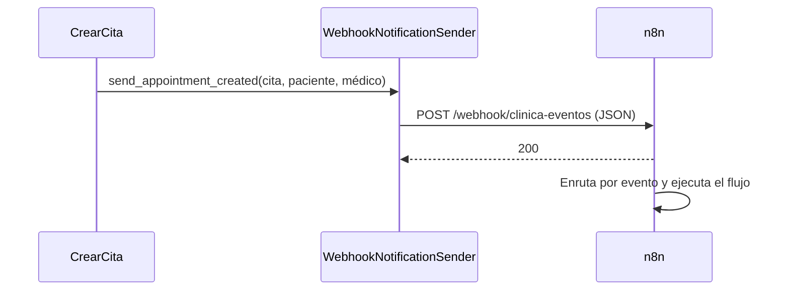

# ADR 004: Enviar eventos de citas a n8n mediante webhook

## Estado

Aceptado.

## Contexto

La clínica necesita automatizar acciones posteriores a una cita, como enviar
confirmaciones al paciente o avisar al médico. Esos flujos cambian con
frecuencia y dependen de servicios externos (correo, mensajería, calendarios).
No deben vivir en los casos de uso ni requerir cambios en el backend cada vez
que se ajustan.

## Decisión

Agregaremos un adaptador de salida `WebhookNotificationSender` que implementa
el puerto `NotificationSender` y envía como JSON a un webhook de n8n los
eventos `cita_creada` y `cita_cancelada`. Como la cancelación es idempotente,
solo se notifica cuando una cita activa pasa a `cancelada`. El contenedor de
aplicación lo elige cuando existe `NOTIFICATION_WEBHOOK_URL`; si no, conserva
`ConsoleNotificationSender`.
n8n se ejecuta como servicio de Compose y su puerto solo se publica en
`127.0.0.1`. Para que el proyecto funcione en cualquier equipo sin pasos
manuales, `n8n/arranque.sh` registra la credencial de Discord e importa y
publica el flujo versionado en cada arranque, y la cuenta de administración se
define con las variables `N8N_INSTANCE_OWNER_*`.

El adaptador usa `urllib` de la biblioteca estándar, con un tiempo de espera
de 5 segundos. Si `NOTIFICATION_WEBHOOK_TOKEN` está definido, lo envía en el
encabezado `X-Clinica-Token` para que el webhook lo valide con *Header Auth*.

## Consecuencias

- Los flujos de notificación se modifican en n8n sin tocar el dominio ni los
  casos de uso.
- Una falla de n8n no impide crear ni cancelar la cita: el adaptador informa
  el error en `stderr` y la operación continúa. El evento se pierde; no hay
  reintentos ni cola.
- El envío es síncrono dentro de la petición HTTP; en el peor caso agrega el
  tiempo de espera a la respuesta. Una cola o un envío en segundo plano se
  reconsiderarán si el volumen lo requiere.
- El cuerpo del evento incluye el contacto del paciente. Al exponer n8n fuera
  del equipo local se deberá usar HTTPS y autenticación en el webhook.
- La URL del webhook de Discord y la cuenta de n8n son públicas en el
  repositorio. Se acepta porque el proyecto es académico, no maneja datos
  reales y n8n solo escucha en `127.0.0.1`; cualquiera podría publicar en el
  canal de avisos. Fuera de la demostración, la URL se definirá en `.env` y el
  webhook actual se regenerará.
- El flujo del repositorio reemplaza en cada arranque los cambios hechos en el
  editor de n8n que no se hayan exportado.
